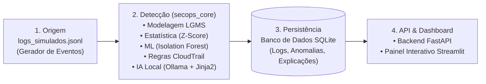

# 🛡️ Planejamento Scrum & Backlog Linear — Projeto SecOps Assistido (Mãos na Tech)

> **Espaço de Trabalho Linear:** `Mãos na Tech` (`MAO`)  
> **Projeto no Linear:** [SecOps Assistido](https://linear.app/maos-na-tech/project/secops-assistido-d1be10bd466f)  
> **Documento PRD/Scrum no Linear:** [Planejamento Scrum (4 Semanas), Cerimônias e Especificação de Tasks](https://linear.app/maos-na-tech/document/planejamento-scrum-4-semanas-cerimonias-e-especificacao-de-tasks-e7a9e9656fc7)  
> **Duração:** 4 Semanas (4 Sprints de 1 semana / 4 Milestones no Linear)  
> **Stack Tecnológica:** Python (`secops_core`), JSONL, LGMS, Z-Score, Isolation Forest (Scikit-Learn), Regras CloudTrail, Ollama + Jinja2, SQLite, FastAPI e Streamlit.

---

## 📌 1. Visão Geral do Projeto & Arquitetura

### 1.1 Objetivo do Produto
Construir um pipeline local de **SecOps Assistido por IA** a custo zero que gera logs simulados de eventos de infraestrutura e segurança (`logs_simulados.jsonl`), detecta anomalias combinando métodos estatísticos, aprendizado de máquina e regras de segurança, traduz os alertas técnicos em explicações claras via LLM local (**Ollama/Jinja2**), armazena os resultados em **SQLite** e disponibiliza a consulta e visualização através de uma API **FastAPI** e um dashboard interativo em **Streamlit**.

### 1.2 Arquitetura em 4 Camadas

### 1.3 Papéis na Equipe (Mãos na Tech)
| Papel | Responsabilidade Principal na Arquitetura Local |
| :--- | :--- |
| **Arquiteto de Solução / Tech Lead** | Define contratos de dados (LGMS), arquitetura do pacote `secops_core`, modelagem SQLite e integração ponta a ponta. |
| **Cloud Practitioner / SecOps Analyst** | Projeta cenários de ataques e eventos suspeitos para `logs_simulados.jsonl` e implementa o motor de regras determinísticas inspiradas no AWS CloudTrail. |
| **Cientista de Dados** | Implementa o pipeline de features, detecção estatística (**Z-Score**) e modelo não supervisionado (**Isolation Forest**). |
| **Backend Developer** | Constrói a integração com IA local (**Ollama** + templates **Jinja2**), persistência em **SQLite** e endpoints REST com **FastAPI**. |
| **Infraestrutura / Frontend Developer** | Desenvolve o painel interativo em **Streamlit**, automação de execução local (scripts/Docker/ambiente) e validação de segurança/qualidade. |

---

## 📅 2. Planejamento das Cerimônias Scrum (4 Semanas)

Para um projeto intensivo de **4 semanas**, adotamos **4 Sprints de 1 semana** (que podem ser agrupadas em 2 *Cycles* de 2 semanas no Linear, mantendo checkpoints semanais de entrega).

### 2.1 Cadência Padrão das Cerimônias

| Cerimônia | Quando Ocorre | Timebox | Objetivo Principal | Participantes |
| :--- | :--- | :--- | :--- | :--- |
| **Sprint Planning** | Segunda-feira (Início da Semana) | 45 - 60 min | Definir a Meta da Sprint, selecionar tasks do `Backlog` para `Todo` no Linear e confirmar o *Definition of Ready (DoR)*. | Todo o Time |
| **Daily Scrum** | Terça a Sexta (ou Assíncrono + Síncrono) | 15 min | Alinhar progresso diário, atualizar cards no Linear (`In Progress` / `In Review`) e remover impedimentos técnicos. | Todo o Time |
| **Backlog Refinement (Grooming)** | Quarta-feira (Meio da Semana) | 30 min | Detalhar, estimar (Fibonacci) e fatiar as tasks da semana seguinte no Linear. | Tech Lead + Representantes |
| **Sprint Review (Demo)** | Sexta-feira (Final da Tarde) | 30 - 45 min | Demonstrar o incremento funcional da semana rodando localmente (código + testes + preview). | Todo o Time + Mentores |
| **Sprint Retrospective** | Sexta-feira (Logo após a Review) | 30 min | Avaliar o que funcionou bem, o que pode melhorar no fluxo (Git/Linear/IA) e definir 1 a 2 ações práticas para a próxima semana. | Todo o Time |

---

### 2.2 Roteiro Detalhado de Cerimônias por Semana

#### 🗓️ Semana 1 — Fundação, Geração de Logs, Modelagem LGMS e SQLite
* **Sprint Planning 1 (Seg, Dia 1):**
  * **Pauta:** Alinhamento do PRD, configuração do workspace `Mãos na tech` no Linear, definição do schema LGMS e seleção das tasks `SEC-01` a `SEC-04`.
  * **Meta da Sprint 1:** Ter o gerador de `logs_simulados.jsonl` funcional, o parser/modelagem LGMS validado e a camada de persistência SQLite criada.
* **Daily Scrum (Ter-Sex, Dias 2 a 5):**
  * Foco em destravar o formato dos eventos JSONL e garantir que os campos necessários para Z-Score, Isolation Forest e Regras CloudTrail estejam presentes no schema LGMS.
* **Refinement 1 (Qua, Dia 3):**
  * Revisão dos hiperparâmetros e features que o Cientista de Dados e o SecOps Analyst usarão na Semana 2 (`SEC-05` a `SEC-08`).
* **Sprint Review 1 (Sex, Dia 5):**
  * **Demo:** Execução do script gerador criando `logs_simulados.jsonl` com tráfego normal e anomalias injetadas + ingestão inicial no banco SQLite.
* **Sprint Retrospective 1 (Sex, Dia 5):**
  * Avaliação do setup inicial de ambiente Python, padrões de branch/PR e clareza das tasks no Linear.

#### 🗓️ Semana 2 — Motor de Detecção (`secops_core`): Z-Score, Isolation Forest e Regras CloudTrail
* **Sprint Planning 2 (Seg, Dia 6):**
  * **Pauta:** Planejamento da construção do núcleo analítico `secops_core` (`SEC-05` a `SEC-08`).
  * **Meta da Sprint 2:** Detectar anomalias nos logs simulados combinando Z-Score, Isolation Forest e Regras CloudTrail, gravando os scores e flags de alerta no SQLite.
* **Daily Scrum (Ter-Sex, Dias 7 a 10):**
  * Sincronização sobre normalização de scores entre os 3 detectores (estatístico, ML e regras) e calibração de falsos positivos.
* **Refinement 2 (Qua, Dia 8):**
  * Definição do contrato de prompt Jinja2 para o Ollama e dos endpoints da FastAPI para a Semana 3 (`SEC-09` a `SEC-12`).
* **Sprint Review 2 (Sex, Dia 10):**
  * **Demo:** Execução do pipeline `secops_core` sobre `logs_simulados.jsonl`, exibindo no terminal e no SQLite quais eventos foram marcados por Z-Score, Isolation Forest e Regras CloudTrail.
* **Sprint Retrospective 2 (Sex, Dia 10):**
  * Ajustes de performance na detecção e revisão da qualidade dos testes unitários do fim do *Cycle 1*.

#### 🗓️ Semana 3 — Explicações via IA Local (Ollama/Jinja2) e API REST (FastAPI)
* **Sprint Planning 3 (Seg, Dia 11):**
  * **Pauta:** Seleção das tasks de integração com LLM local e exposição via FastAPI (`SEC-09` a `SEC-12`).
  * **Meta da Sprint 3:** Gerar explicações em linguagem simples para cada anomalia via Ollama/Jinja2, persistir no SQLite e expor todos os dados e métricas via FastAPI documentada (Swagger/OpenAPI).
* **Daily Scrum (Ter-Sex, Dias 12 a 15):**
  * Acompanhamento de latência/timeout do Ollama local, fallback caso o serviço Ollama esteja offline e validação dos contratos Pydantic na FastAPI.
* **Refinement 3 (Qua, Dia 13):**
  * Detalhamento dos componentes visuais e filtros do dashboard Streamlit e checklist de entrega final da Semana 4 (`SEC-13` a `SEC-16`).
* **Sprint Review 3 (Sex, Dia 15):**
  * **Demo:** Chamadas ao vivo nos endpoints da FastAPI (`/logs`, `/anomalies`, `/stats`, `/analyze`) retornando anomalias detectadas e explicadas em português claro pelo Ollama.
* **Sprint Retrospective 3 (Sex, Dia 15):**
  * Análise da qualidade dos prompts Jinja2 e preparação para a reta final de integração com o frontend.

#### 🗓️ Semana 4 — Painel Streamlit, Integração Ponta a Ponta, Testes e Entrega Final
* **Sprint Planning 4 (Seg, Dia 16):**
  * **Pauta:** Seleção das tasks de visualização Streamlit, orquestração completa e documentação final (`SEC-13` a `SEC-16`).
  * **Meta da Sprint 4:** Entregar o painel interativo em Streamlit consumindo a FastAPI, com fluxo ponta a ponta automatizado, testes validados e documentação pronta para apresentação Mãos na Tech.
* **Daily Scrum (Ter-Sex, Dias 17 a 20):**
  * Foco em UX do painel Streamlit, responsividade dos gráficos, testes de integração e checklist de segurança/custo zero.
* **Sprint Review 4 / Demo Final (Sex, Dia 20):**
  * **Demo Oficial:** Apresentação completa do fluxo: Geração de `logs_simulados.jsonl` ➔ Detecção híbrida (`secops_core`) ➔ Explicação via IA Local (`Ollama/Jinja2`) ➔ Persistência `SQLite` ➔ API `FastAPI` ➔ Dashboard `Streamlit`.
* **Sprint Retrospective Final (Sex, Dia 20):**
  * Consolidação das lições aprendidas do projeto, celebração das entregas e fechamento do projeto no Linear.

---

## 🗂️ 3. Mapa Resumido do Backlog Sincronizado no Linear (4 Semanas / 20 Issues: `MAO-5` a `MAO-24`)

| ID Linear | Semana / Milestone | Título da Issue no Linear | Status Linear | Prioridade | Estimativa (Pts) | Labels |
| :--- | :---: | :--- | :---: | :---: | :---: | :--- |
| **MAO-5** | Semana 1 | `[Scrum/Sprint 1] Conduzir Cerimônias da Semana 1 (Fundação, Logs JSONL, LGMS e SQLite)` | 🟡 `In Review` | High (P2) | - | `scrum` |
| **MAO-6** | Semana 1 | `[Infra/Setup] Estruturar repositório Python, pacote secops_core e ambiente virtual` | 🟡 `In Review` | High (P2) | 2 | `secops_core`, `qa-docs` |
| **MAO-7** | Semana 1 | `[Origem/Logs] Implementar gerador de logs simulados em formato JSONL (logs_simulados.jsonl)` | 🟡 `In Review` | Urgent (P1) | 3 | `secops_core`, `feature` |
| **MAO-8** | Semana 1 | `[Core/LGMS] Implementar modelagem, normalização e parser de logs (LGMS) no secops_core` | 🟡 `In Review` | Urgent (P1) | 3 | `secops_core`, `feature` |
| **MAO-9** | Semana 1 | `[DB/SQLite] Criar camada de persistência SQLite e modelos de tabelas para logs e alertas` | 🟡 `In Review` | High (P2) | 3 | `sqlite`, `feature` |
| **MAO-10** | Semana 2 | `[Scrum/Sprint 2] Conduzir Cerimônias da Semana 2 (Motor secops_core: Z-Score, Isolation Forest e CloudTrail)` | ⚪ `Backlog` | High (P2) | - | `scrum` |
| **MAO-11** | Semana 2 | `[Detecção/Stats] Implementar detector estatístico de anomalias volumétricas e temporais via Z-Score` | ⚪ `Backlog` | High (P2) | 3 | `secops_core`, `feature` |
| **MAO-12** | Semana 2 | `[Detecção/ML] Implementar detector de anomalias multivariadas com Isolation Forest` | ⚪ `Backlog` | High (P2) | 5 | `secops_core`, `feature` |
| **MAO-13** | Semana 2 | `[Detecção/CloudTrail] Implementar motor de regras determinísticas de segurança para eventos CloudTrail` | ⚪ `Backlog` | High (P2) | 3 | `secops_core`, `feature` |
| **MAO-14** | Semana 2 | `[Core/Pipeline] Unificar pipeline híbrido de detecção no secops_core e persistir resultados no SQLite` | ⚪ `Backlog` | Urgent (P1) | 5 | `secops_core`, `sqlite`, `feature` |
| **MAO-15** | Semana 3 | `[Scrum/Sprint 3] Conduzir Cerimônias da Semana 3 (IA Local Ollama/Jinja2 e API FastAPI)` | ⚪ `Backlog` | High (P2) | - | `scrum` |
| **MAO-16** | Semana 3 | `[IA/Jinja2] Criar templates Jinja2 estruturados para contextualização e explicação de alertas SecOps` | ⚪ `Backlog` | High (P2) | 2 | `ollama-ia`, `secops_core` |
| **MAO-17** | Semana 3 | `[IA/Ollama] Implementar cliente de integração com Ollama local e fallback resiliente para explicações` | ⚪ `Backlog` | Urgent (P1) | 5 | `ollama-ia`, `secops_core`, `feature` |
| **MAO-18** | Semana 3 | `[API/FastAPI] Desenvolver endpoints REST para consulta de logs, anomalias, métricas e explicações` | ⚪ `Backlog` | Urgent (P1) | 5 | `fastapi`, `sqlite`, `feature` |
| **MAO-19** | Semana 3 | `[API/Trigger] Implementar endpoint de ingestão/execução sob demanda do pipeline na FastAPI` | ⚪ `Backlog` | Medium (P3) | 3 | `fastapi`, `secops_core` |
| **MAO-20** | Semana 4 | `[Scrum/Sprint 4] Conduzir Cerimônias da Semana 4 (Painel Streamlit, QA e Demo Final MãosNaTech)` | ⚪ `Backlog` | High (P2) | - | `scrum` |
| **MAO-21** | Semana 4 | `[UI/Streamlit] Construir visão executiva de KPIs, séries temporais e distribuição de anomalias no Streamlit` | ⚪ `Backlog` | High (P2) | 3 | `streamlit`, `feature` |
| **MAO-22** | Semana 4 | `[UI/Streamlit] Criar painel de investigação de alertas com filtros e exibição das explicações da IA` | ⚪ `Backlog` | High (P2) | 5 | `streamlit`, `ollama-ia`, `feature` |
| **MAO-23** | Semana 4 | `[QA/Tests] Implementar suíte de testes automatizados (pytest) e validação ponta a ponta do pipeline` | ⚪ `Backlog` | High (P2) | 3 | `qa-docs`, `secops_core` |
| **MAO-24** | Semana 4 | `[Docs/Release] Elaborar documentação técnica, guia de execução local a custo zero e checklist MãosNaTech` | ⚪ `Backlog` | Medium (P3) | 2 | `qa-docs` |

---

## 📝 4. Especificação Completa das Tasks (Prontas para o Linear)

Abaixo estão todas as 16 tasks detalhadas segundo a *Definition of Ready (DoR)* e *Definition of Done (DoD)* do guia de engenharia.

---

### 🔹 SEMANA 1: Fundação, Origem (`logs_simulados.jsonl`), LGMS e Persistência SQLite

---

#### `SEC-01` — `[Infra/Setup] Estruturar repositório Python, pacote secops_core e ambiente virtual` *(Status: 🟡 In Review)*
* **Semana / Sprint:** Semana 1 (Sprint 1)
* **Prioridade:** High (P2) | **Estimativa:** 2 pts | **Labels:** `infra`, `setup`, `backend`

##### 1. Contexto & Problema
O time precisa de uma estrutura padronizada de diretórios e gerenciamento de dependências para que todos os membros (Dados, Backend, SecOps e Frontend) trabalhem de forma isolada e reprodutível sem conflitos de pacotes.

##### 2. Escopo Técnico & Arquitetura
* **O que DEVE ser alterado/criado:**
  * Estrutura modular contendo `secops_core/` (`__init__.py`, `generator.py`, `lgms.py`, `detectors/`, `explainer/`, `db.py`), `api/` (`main.py`, `schemas.py`), `dashboard/` (`app.py`), `data/` e `tests/`.
  * Arquivo `requirements.txt` / `pyproject.toml` com `fastapi`, `uvicorn`, `streamlit`, `scikit-learn`, `pandas`, `numpy`, `jinja2`, `httpx`/`requests`, `pydantic` e `pytest`.
  * Arquivo `.env.example` com variáveis de configuração local (`SQLITE_DB_PATH`, `OLLAMA_BASE_URL`, `OLLAMA_MODEL`, `API_BASE_URL`).
* **O que NÃO deve ser alterado:** Não implementar a lógica de negócio dos detectores nesta task.

##### 3. Critérios de Aceitação (Definition of Done)
* [x] Estrutura de pastas criada e importação do pacote `secops_core` funcionando sem erros.
* [x] Instalação limpa via `pip install -r requirements.txt` (ou `uv`) validada.
* [x] Configurações carregadas via variáveis de ambiente com valores default seguros para execução local.

##### 4. Anexos & Referências
* Arquitetura em 4 camadas do projeto SecOps Assistido.

---

#### `SEC-02` — `[Origem/Logs] Implementar gerador de logs simulados em formato JSONL (logs_simulados.jsonl)` *(Status: 🟡 In Review)*
* **Semana / Sprint:** Semana 1 (Sprint 1)
* **Prioridade:** Urgent (P1) | **Estimativa:** 3 pts | **Labels:** `data`, `secops`, `feature`

##### 1. Contexto & Problema
Para testar e demonstrar o pipeline de detecção de anomalias a custo zero, precisamos de uma fonte de dados local realista que simule eventos de auditoria e segurança estilo AWS CloudTrail/aplicação em formato JSON Lines (`logs_simulados.jsonl`), contendo tanto tráfego basal legítimo quanto padrões anômalos injetados.

##### 2. Escopo Técnico & Arquitetura
* **O que DEVE ser alterado/criado:**
  * Módulo `secops_core/generator.py` e CLI/função para gerar `data/logs_simulados.jsonl`.
  * Simulação de eventos normais (ex: `ConsoleLogin` com sucesso em horário comercial, `GetObject`, `ListBuckets`, `DescribeInstances`) e eventos anômalos/ataques (ex: rajadas de `ConsoleLogin` com falha / brute force, chamadas em horários atípicos, `DeleteTrail`, `PutUserPolicy` para escalação de privilégio, IPs externos suspeitos, volume anômalo de requisições).
  * Parametrização da quantidade de registros, semente aleatória (`seed`) e taxa de anomalia injetada.
* **O que NÃO deve ser alterado:** Não realizar a detecção ou gravação no banco dentro do gerador; ele deve produzir exclusivamente o arquivo `.jsonl` bruto.

##### 3. Critérios de Aceitação (Definition of Done)
* [x] O script gera o arquivo `logs_simulados.jsonl` válido (1 objeto JSON por linha).
* [x] Cada registro inclui campos essenciais como `timestamp`, `event_id`, `event_name`, `event_source`, `user_identity`, `source_ip`, `aws_region`, `status`, `error_code`, `request_Count` / `bytes_transferred` e metadados contextuais.
* [x] O dataset gerado contém pelo menos 5 cenários distintos de anomalia documentados para validação posterior.

##### 4. Anexos & Referências
* Especificação de eventos AWS CloudTrail e proposta MãosNaTech (Solução 03).

---

#### `SEC-03` — `[Core/LGMS] Implementar modelagem, normalização e parser de logs (LGMS) no secops_core` *(Status: 🟡 In Review)*
* **Semana / Sprint:** Semana 1 (Sprint 1)
* **Prioridade:** Urgent (P1) | **Estimativa:** 3 pts | **Labels:** `secops_core`, `lgms`, `backend`

##### 1. Contexto & Problema
Logs brutos em `logs_simulados.jsonl` podem apresentar variações de formato ou campos aninhados. É necessário um módulo de **Modelagem de Logs (LGMS - Log Modeling & Schema)** em `secops_core` para validar, padronizar e extrair atributos estruturados (features numéricas, temporais e categóricas) antes de enviá-los aos motores estatístico, ML e de regras.

##### 2. Escopo Técnico & Arquitetura
* **O que DEVE ser alterado/criado:**
  * Módulo `secops_core/lgms.py` com schemas padronizados (Pydantic/Dataclasses) representando o modelo canônico de log LGMS.
  * Parser de leitura eficiente em streaming/batch do arquivo `logs_simulados.jsonl`.
  * Extrator de features derivadas (ex: hora do dia, dia da semana, frequência por IP/usuário na janela de tempo, indicador de erro, categoria de ação).
* **O que NÃO deve ser alterado:** Não acoplar regras específicas de negócio do CloudTrail dentro do parser estrutural.

##### 3. Critérios de Aceitação (Definition of Done)
* [x] O módulo LGMS lê `logs_simulados.jsonl` e converte 100% das linhas válidas para objetos canônicos tipados.
* [x] Linhas corrompidas ou malformadas são tratadas com log de warning sem derrubar o pipeline.
* [x] Exporta DataFrame/matriz de features pronta para consumo pelo Z-Score e Isolation Forest.

##### 4. Anexos & Referências
* Camada de Detecção (`secops_core` - modelagem LGMS).

---

#### `SEC-04` — `[DB/SQLite] Criar camada de persistência SQLite e modelos de tabelas para logs e alertas` *(Status: 🟡 In Review)*
* **Semana / Sprint:** Semana 1 (Sprint 1)
* **Prioridade:** High (P2) | **Estimativa:** 3 pts | **Labels:** `database`, `sqlite`, `backend`

##### 1. Contexto & Problema
Os logs processados, os scores de cada detector (Z-Score, Isolation Forest, Regras CloudTrail) e as explicações geradas pela IA precisam ser armazenados de forma persistente e consultável localmente sem depender de bancos pagos em nuvem.

##### 2. Escopo Técnico & Arquitetura
* **O que DEVE ser alterado/criado:**
  * Módulo `secops_core/db.py` gerenciando a conexão SQLite (`secops.db`), inicialização de schema (`CREATE TABLE IF NOT EXISTS`) e índices de busca.
  * Tabela principal `processed_logs` / `security_alerts` contendo: identificadores do evento, campos normalizados LGMS, `zscore_value`, `is_zscore_anomaly`, `iforest_score`, `is_iforest_anomaly`, `cloudtrail_rules_triggered` (JSON), `final_severity`, `is_anomaly`, `ai_explanation` e `processed_at`.
  * Funções CRUD/Repositório para inserção em lote (`bulk_insert`), atualização de explicação da IA e consultas filtradas.
* **O que NÃO deve ser alterado:** Não expor rotas HTTP neste módulo (responsabilidade da FastAPI).

##### 3. Critérios de Aceitação (Definition of Done)
* [x] Inicialização automática do arquivo SQLite e criação das tabelas e índices (`timestamp`, `is_anomaly`, `final_severity`).
* [x] Operações de inserção em lote e leitura filtrada testadas e executando em menos de 100ms para 5.000 registros.
* [x] Suporte a idempotência (evitar duplicação do mesmo `event_id` ao reprocessar).

##### 4. Anexos & Referências
* Camada de Persistência SQLite da especificação do projeto.

---

### 🔹 SEMANA 2: Motor de Detecção (`secops_core`) — Z-Score, Isolation Forest e Regras CloudTrail

---

#### `SEC-05` — `[Detecção/Stats] Implementar detector estatístico de anomalias volumétricas e temporais via Z-Score` *(Status: 🟡 In Review)*
* **Semana / Sprint:** Semana 2 (Sprint 2)
* **Prioridade:** High (P2) | **Estimativa:** 3 pts | **Labels:** `secops_core`, `ml-stats`, `feature`

##### 1. Contexto & Problema
Picos repentinos de atividade (como tentativas de força bruta, varredura de recursos ou exfiltração de dados) desviam significativamente da média histórica. Precisamos de um detector estatístico baseado em **Z-Score** dentro do `secops_core`.

##### 2. Escopo Técnico & Arquitetura
* **O que DEVE ser alterado/criado:**
  * Módulo `secops_core/detectors/zscore_detector.py`.
  * Cálculo do Z-Score ($Z = \frac{x - \mu}{\sigma}$) sobre métricas agregadas e por evento (ex: taxa de eventos por usuário/IP em janela de tempo, bytes transferidos, latência/erros).
  * Limiar configurável (ex: $|Z| > 3.0$ por padrão) e proteção contra divisão por zero quando $\sigma = 0$.
* **O que NÃO deve ser alterado:** Não alterar os dados originais do evento; apenas anexar o score estatístico e a flag booleana.

##### 3. Critérios de Aceitação (Definition of Done)
* [x] Calcula corretamente o Z-Score e identifica outliers em séries simuladas com picos de eventos.
* [x] Limiar (`threshold`) configurável via parâmetro/ambiente.
* [x] Testes unitários cobrindo distribuição normal, pico extremo e desvio padrão zero.

##### 4. Anexos & Referências
* Camada de Detecção (`secops_core` - estatística Z-Score).

---

#### `SEC-06` — `[Detecção/ML] Implementar detector de anomalias multivariadas com Isolation Forest` *(Status: 🟡 In Review)*
* **Semana / Sprint:** Semana 2 (Sprint 2)
* **Prioridade:** High (P2) | **Estimativa:** 5 pts | **Labels:** `secops_core`, `ml-stats`, `feature`

##### 1. Contexto & Problema
Nem toda anomalia é um simples pico em uma única variável; ataques furtivos combinam horário incomum, tipo de evento raro, origem atípica e volume moderado. O algoritmo **Isolation Forest** permite detectar anomalias multivariadas de forma não supervisionada.

##### 2. Escopo Técnico & Arquitetura
* **O que DEVE ser alterado/criado:**
  * Módulo `secops_core/detectors/isolation_forest.py` utilizando `sklearn.ensemble.IsolationForest`.
  * Pré-processamento da matriz de features gerada pelo LGMS (encoding de variáveis categóricas/frequência e escalonamento numérico).
  * Retorno da predição (`-1` para anomalia, `1` para normal convertidos para booleano `is_iforest_anomaly`) e do `decision_function` / `anomaly_score` contínuo.
  * Parametrização de `contamination`, `n_estimators` e `random_state`.
* **O que NÃO deve ser alterado:** Não exigir GPU ou dependências pesadas de Deep Learning.

##### 3. Critérios de Aceitação (Definition of Done)
* [x] O modelo treina e infere sobre o lote de logs LGMS retornando score contínuo e classificação binária para cada evento.
* [x] Reprodutibilidade garantida através de `random_state` fixo.
* [x] Testes validando que eventos multivariados anômalos recebem scores inferiores/mais anômalos que o tráfego basal.

##### 4. Anexos & Referências
* Camada de Detecção (`secops_core` - aprendizado de máquina Isolation Forest).

---

#### `SEC-07` — `[Detecção/CloudTrail] Implementar motor de regras determinísticas de segurança para eventos CloudTrail` *(Status: 🟡 In Review)*
* **Semana / Sprint:** Semana 2 (Sprint 2)
* **Prioridade:** High (P2) | **Estimativa:** 3 pts | **Labels:** `secops_core`, `cloudtrail`, `secops`

##### 1. Contexto & Problema
Certos eventos de segurança são críticos por definição (ex: desativar logs de auditoria `StopLogging`/`DeleteTrail`, criar chaves de acesso root, alterar políticas IAM sensíveis ou múltiplos erros `AccessDenied`), independentemente de frequência estatística.

##### 2. Escopo Técnico & Arquitetura
* **O que DEVE ser alterado/criado:**
  * Módulo `secops_core/detectors/cloudtrail_rules.py`.
  * Catálogo de regras determinísticas baseadas nas boas práticas de segurança AWS CloudTrail (ex: `RULE_IAM_PRIVILEGE_ESCALATION`, `RULE_TRAIL_TAMPERING`, `RULE_ROOT_ACTIVITY`, `RULE_BRUTE_FORCE_CONSOLE`, `RULE_UNAUTHORIZED_API_BURST`, `RULE_SENSITIVE_S3_PUBLIC_ACCESS`).
  * Cada regra acionada deve retornar código da regra, nome amigável, severidade (`LOW`, `MEDIUM`, `HIGH`, `CRITICAL`) e motivo técnico.
* **O que NÃO deve ser alterado:** As regras devem ser modulares e fáceis de estender sem modificar o motor principal.

##### 3. Critérios de Aceitação (Definition of Done)
* [x] Pelo menos 6 regras determinísticas de CloudTrail implementadas e documentadas.
* [x] Cada log avaliado recebe a lista de regras violadas (ou lista vazia se nenhuma regra for disparada).
* [x] Testes unitários garantindo 100% de precisão nos eventos que violam cada regra.

##### 4. Anexos & Referências
* Camada de Detecção (`secops_core` - regras do CloudTrail) e Checklist IAM/Segurança MãosNaTech.

---

#### `SEC-08` — `[Core/Pipeline] Unificar pipeline híbrido de detecção no secops_core e persistir resultados no SQLite` *(Status: 🟡 In Review)*
* **Semana / Sprint:** Semana 2 (Sprint 2)
* **Prioridade:** Urgent (P1) | **Estimativa:** 5 pts | **Labels:** `secops_core`, `pipeline`, `backend`

##### 1. Contexto & Problema
Com o LGMS, Z-Score, Isolation Forest e Regras CloudTrail construídos, precisamos de um orquestrador no `secops_core` que execute todo o fluxo de detecção em sequência, consolide a severidade final do alerta (`ensemble`/fusão de decisão) e grave os resultados no banco SQLite.

##### 2. Escopo Técnico & Arquitetura
* **O que DEVE ser alterado/criado:**
  * Módulo `secops_core/pipeline.py`.
  * Regra de consolidação: um evento é marcado como `is_anomaly = True` se qualquer um dos detectores o sinalizar, calculando a severidade final (`LOW`, `MEDIUM`, `HIGH`, `CRITICAL`) com base na combinação de evidências (ex: anomalia detectada simultaneamente por Regra CloudTrail + Isolation Forest + Z-Score recebe prioridade máxima).
  * Persistência transacional dos resultados no SQLite (`secops_core/db.py`).
* **O que NÃO deve ser alterado:** A geração de explicações via IA deve poder rodar acoplada ou em etapa separada para anomalias detectadas.

##### 3. Critérios de Aceitação (Definition of Done)
* [x] Execução de ponta a ponta: `logs_simulados.jsonl` ➔ `LGMS` ➔ `Z-Score + Isolation Forest + CloudTrail Rules` ➔ `SQLite`.
* [x] Cálculo claro de severidade combinada e justificativa técnica estruturada de quais detectores dispararam.
* [x] CLI ou script de execução rápida (`python -m secops_core.pipeline`) funcional.

##### 4. Anexos & Referências
* Integração dos módulos da Semana 1 e Semana 2.

---

### 🔹 SEMANA 3: Explicações via IA Local (Ollama/Jinja2) e API REST (FastAPI)

---

#### `SEC-09` — `[IA/Jinja2] Criar templates Jinja2 estruturados para contextualização e explicação de alertas SecOps` *(Status: 🟡 In Review)*
* **Semana / Sprint:** Semana 3 (Sprint 3)
* **Prioridade:** High (P2) | **Estimativa:** 2 pts | **Labels:** `ai`, `jinja2`, `secops_core`

##### 1. Contexto & Problema
Para que o modelo de linguagem local (Ollama) gere explicações consistentes, sem alucinações e compreensíveis por analistas juniores ou gestores, o prompt precisa ser rigorosamente estruturado usando templates **Jinja2** injetados com os dados do evento e os resultados dos detectores.

##### 2. Escopo Técnico & Arquitetura
* **O que DEVE ser alterado/criado:**
  * Diretório/módulo `secops_core/explainer/templates/` com template `alert_explanation.j2` e renderizador em Python via `jinja2`.
  * O template deve injetar: dados do log (usuário, IP, evento, horário), métricas detectadas (`zscore`, `iforest_score`, `cloudtrail_rules`) e severidade.
  * Instrução clara no prompt para responder em português estruturado contendo: **1) O que aconteceu (Resumo Simples)**, **2) Por que foi considerado anômalo**, **3) Risco Potencial** e **4) Ação Recomendada**.
* **O que NÃO deve ser alterado:** Não usar strings concatenadas hardcoded fora do sistema de templates Jinja2.

##### 3. Critérios de Aceitação (Definition of Done)
* [x] Renderização do template Jinja2 testada com diferentes combinações de anomalias (apenas estatística, apenas ML, apenas regra ou híbrida).
* [x] Prompt resultante enxuto, determinístico e otimizado para modelos locais leves (ex: `llama3.2`, `qwen2.5`, `mistral` ou `phi3`).

##### 4. Anexos & Referências
* Camada de Detecção (`secops_core` - explicações via IA local Ollama/Jinja2).

---

#### `SEC-10` — `[IA/Ollama] Implementar cliente de integração com Ollama local e fallback resiliente para explicações` *(Status: 🟡 In Review)*
* **Semana / Sprint:** Semana 3 (Sprint 3)
* **Prioridade:** Urgent (P1) | **Estimativa:** 5 pts | **Labels:** `ai`, `ollama`, `backend`

##### 1. Contexto & Problema
As anomalias detectadas precisam ser enviadas ao servidor **Ollama** local para gerar a explicação em linguagem natural e atualizar o registro correspondente no SQLite. Além disso, caso o computador do usuário não esteja com o Ollama ativo no momento do teste, o sistema precisa ter um fallback determinístico baseado em template Jinja2 para nunca quebrar a aplicação.

##### 2. Escopo Técnico & Arquitetura
* **O que DEVE ser alterado/criado:**
  * Módulo `secops_core/explainer/ollama_client.py`.
  * Integração HTTP com a API local do Ollama (`POST http://localhost:11434/api/generate` com `stream=False`).
  * Tratamento de timeout, verificação de saúde (`healthcheck`) do Ollama e modo de **Fallback Inteligente Jinja2** (gera explicação estruturada em português a partir dos dados dos detectores caso o serviço Ollama esteja indisponível).
  * Atualização da coluna `ai_explanation` no banco SQLite.
* **O que NÃO deve ser alterado:** Não utilizar APIs de LLMs pagas externas por padrão (manter diretriz de custo zero e execução 100% local).

##### 3. Critérios de Aceitação (Definition of Done)
* [x] Gera explicações reais via Ollama local quando o serviço está ativo e persiste no SQLite.
* [x] Quando o Ollama está desligado ou inacessível, aciona automaticamente o fallback sem lançar exceção não tratada.
* [x] Testes unitários com mock da resposta do Ollama e teste do modo fallback.

##### 4. Anexos & Referências
* Proposta MãosNaTech: "Usa IA para explicar o alerta em linguagem simples — sempre a custo zero".

---

#### `SEC-11` — `[API/FastAPI] Desenvolver endpoints REST para consulta de logs, anomalias, métricas e explicações` *(Status: 🟡 In Review)*
* **Semana / Sprint:** Semana 3 (Sprint 3)
* **Prioridade:** Urgent (P1) | **Estimativa:** 5 pts | **Labels:** `api`, `fastapi`, `backend`

##### 1. Contexto & Problema
Os dados processados e armazenados no SQLite precisam ser expostos através de uma API REST rápida, tipada e autodocumentada em **FastAPI** para alimentar o painel em Streamlit e permitir integrações externas.

##### 2. Escopo Técnico & Arquitetura
* **O que DEVE ser alterado/criado:**
  * Aplicação `api/main.py` e contratos Pydantic em `api/schemas.py`.
  * Endpoints de leitura:
    * `GET /health`: status da API, do banco SQLite e conectividade com o Ollama.
    * `GET /stats`: resumo executivo (total de logs analisados, total de anomalias, taxa de anomalias, contagem por severidade, contagem por tipo de detector e top eventos/IPs suspeitos).
    * `GET /logs`: listagem paginada de logs processados com filtros (`is_anomaly`, `severity`, `event_name`, `user`, `source_ip`, `detector_type`, `limit`, `offset`).
    * `GET /anomalies/{event_id}`: detalhes completos de um alerta específico incluindo todos os scores e a explicação da IA.
* **O que NÃO deve ser alterado:** O painel Streamlit não deve acessar arquivos internos sem passar pelos contratos definidos ou camada de serviço padronizada.

##### 3. Critérios de Aceitação (Definition of Done)
* [x] Todos os endpoints respondendo com validação Pydantic e status HTTP adequados (`200`, `404`, `422`).
* [x] Documentação automática `/docs` (Swagger UI) acessível e clara.
* [x] Filtros combinados funcionando corretamente nas rotas de listagem.

##### 4. Anexos & Referências
* Camada de API & Dashboard (Exposição dos dados via FastAPI).

---

#### `SEC-12` — `[API/Trigger] Implementar endpoint de ingestão/execução sob demanda do pipeline na FastAPI` *(Status: 🟡 In Review)*
* **Semana / Sprint:** Semana 3 (Sprint 3)
* **Prioridade:** Medium (P3) | **Estimativa:** 3 pts | **Labels:** `api`, `fastapi`, `pipeline`

##### 1. Contexto & Problema
Para tornar a demonstração e a operação interativas pelo painel Streamlit, o usuário deve conseguir disparar a geração de novos logs simulados, rodar a detecção `secops_core` e solicitar a geração/atualização de explicação via IA diretamente por chamadas à API.

##### 2. Escopo Técnico & Arquitetura
* **O que DEVE ser alterado/criado:**
  * Endpoint `POST /pipeline/run`: permite opcionalmente regenerar `logs_simulados.jsonl`, executar o pipeline de detecção (`LGMS` + `Z-Score` + `Isolation Forest` + `CloudTrail Rules`) e persistir no SQLite.
  * Endpoint `POST /anomalies/{event_id}/explain`: gera ou regenera sob demanda a explicação via Ollama/Jinja2 para uma anomalia específica.
* **O que NÃO deve ser alterado:** Evitar bloqueio indefinido da thread principal em lotes gigantes; limitar ou paginar a geração de explicações em lote.

##### 3. Critérios de Aceitação (Definition of Done)
* [x] Chamada a `POST /pipeline/run` processa os logs e retorna o sumário de execução (registros lidos, anomalias detectadas, tempo de execução).
* [x] Chamada a `POST /anomalies/{event_id}/explain` atualiza e retorna a explicação da IA no banco SQLite.

##### 4. Anexos & Referências
* Integração interativa entre FastAPI, `secops_core` e Streamlit.

---

### 🔹 SEMANA 4: Painel Interativo Streamlit, Testes Automatizados e Entrega Final

---

#### `SEC-13` — `[UI/Streamlit] Construir visão executiva de KPIs, séries temporais e distribuição de anomalias no Streamlit` *(Status: 🟡 In Review)*
* **Semana / Sprint:** Semana 4 (Sprint 4)
* **Prioridade:** High (P2) | **Estimativa:** 3 pts | **Labels:** `frontend`, `streamlit`, `dataviz`

##### 1. Contexto & Problema
A equipe de segurança e os avaliadores precisam visualizar rapidamente o panorama geral dos eventos analisados, identificando quando ocorreram picos de anomalias, qual a proporção por severidade e quais detectores (`Z-Score`, `Isolation Forest`, `Regras CloudTrail`) mais atuaram.

##### 2. Escopo Técnico & Arquitetura
* **O que DEVE ser alterado/criado:**
  * Aplicação `dashboard/app.py` em **Streamlit** consumindo os dados da FastAPI.
  * Cards superiores de KPIs (`st.metric`): Total de Logs, Total de Anomalias, % de Anomalias, Alertas Críticos/Altos e Status do Motor IA (Ollama).
  * Gráficos interativos:
    * Série temporal de eventos normais vs. anômalos.
    * Distribuição de alertas por Severidade (`CRITICAL`, `HIGH`, `MEDIUM`, `LOW`).
    * Comparativo de detecções por método (Z-Score vs. Isolation Forest vs. CloudTrail Rules).
    * Top 5 Eventos/IPs/Usuários com mais anomalias.
* **O que NÃO deve ser alterado:** Manter interface limpa, intuitiva e com carregamento rápido.

##### 3. Critérios de Aceitação (Definition of Done)
* [x] Dashboard Streamlit renderiza todos os KPIs e gráficos sem erros consumindo a API FastAPI.
* [x] Botão na barra lateral permitindo disparar `POST /pipeline/run` para simular novos logs e atualizar os gráficos em tempo real.

##### 4. Anexos & Referências
* Camada de API & Dashboard (Visualização interativa por meio de um painel em Streamlit).

---

#### `SEC-14` — `[UI/Streamlit] Criar painel de investigação de alertas com filtros e exibição das explicações da IA` *(Status: 🟡 In Review)*
* **Semana / Sprint:** Semana 4 (Sprint 4)
* **Prioridade:** High (P2) | **Estimativa:** 5 pts | **Labels:** `frontend`, `streamlit`, `ai`

##### 1. Contexto & Problema
Além dos gráficos executivos, o analista SecOps precisa inspecionar cada alerta individualmente, filtrar por severidade ou detector, ver os dados técnicos brutos (LGMS/CloudTrail) lado a lado com a **explicação em linguagem simples gerada pela IA (Ollama/Jinja2)**.

##### 2. Escopo Técnico & Arquitetura
* **O que DEVE ser alterado/criado:**
  * Aba/seção de **Investigação de Alertas & Explicações IA** no painel Streamlit (`dashboard/app.py`).
  * Filtros interativos na sidebar ou topo: Severidade, Tipo de Detector (Z-Score, Isolation Forest, CloudTrail), Nome do Evento e Usuário/IP.
  * Tabela interativa de anomalias e visualização detalhada do alerta selecionado contendo:
    * Badge de severidade e scores exatos (`Z-Score`, `Isolation Forest Score`, `Regras Violadas`).
    * Card destacado com a **Explicação da IA (Ollama/Jinja2)** formatada em Markdown claro + botão "Regenerar Explicação com IA".
    * Visualizador do JSON original/normalizado (LGMS) em expander (`st.expander`).
* **O que NÃO deve ser alterado:** Não expor credenciais ou caminhos sensíveis do sistema na UI.

##### 3. Critérios de Aceitação (Definition of Done)
* [x] O usuário consegue filtrar anomalias, selecionar qualquer alerta e ler a explicação em linguagem simples gerada pela IA.
* [x] O botão de gerar/atualizar explicação aciona a FastAPI (`/explain`) e atualiza a tela imediatamente.

##### 4. Anexos & Referências
* Proposta MãosNaTech: "Identifica padrões incomuns e usa IA para explicar o alerta em linguagem simples".

---

#### `SEC-15` — `[QA/Tests] Implementar suíte de testes automatizados (pytest) e validação ponta a ponta do pipeline` *(Status: 🟡 In Review)*
* **Semana / Sprint:** Semana 4 (Sprint 4)
* **Prioridade:** High (P2) | **Estimativa:** 3 pts | **Labels:** `qa`, `testing`, `secops_core`

##### 1. Contexto & Problema
Para garantir confiabilidade na entrega final e evitar regressões entre as camadas (`logs_simulados.jsonl` ➔ `secops_core` ➔ `SQLite` ➔ `FastAPI`), precisamos de uma suíte de testes automatizados com `pytest`.

##### 2. Escopo Técnico & Arquitetura
* **O que DEVE ser alterado/criado:**
  * Diretório `tests/` contendo:
    * `test_generator_and_lgms.py`: valida geração JSONL e parsing LGMS.
    * `test_detectors.py`: valida Z-Score, Isolation Forest e Regras CloudTrail sobre dados sintéticos controlados.
    * `test_explainer_and_db.py`: valida renderização Jinja2, fallback do Ollama e persistência SQLite em banco temporário.
    * `test_api.py`: valida endpoints da FastAPI usando `TestClient`.
* **O que NÃO deve ser alterado:** Os testes não devem sobrescrever o banco de dados principal de produção/demonstração (`secops.db`).

##### 3. Critérios de Aceitação (Definition of Done)
* [x] Comando `pytest` executa toda a suíte de testes com 100% de aprovação.
* [x] Cobertura de testes abrangendo as 4 camadas da arquitetura (Origem, Detecção, Persistência e API).

##### 4. Anexos & Referências
* Boas práticas de engenharia e DoD do guia Mãos na Tech.

---

#### `SEC-16` — `[Docs/Release] Elaborar documentação técnica, guia de execução local a custo zero e checklist MãosNaTech` *(Status: 🟡 In Review)*
* **Semana / Sprint:** Semana 4 (Sprint 4)
* **Prioridade:** Medium (P3) | **Estimativa:** 2 pts | **Labels:** `docs`, `release`, `governance`

##### 1. Contexto & Problema
Antes de publicar e apresentar a solução, o time precisa cumprir o checklist oficial do programa MãosNaTech: documentar claramente o problema resolvido, registrar a contribuição de cada papel da equipe, comprovar o custo zero e fornecer um passo a passo simples para rodar o projeto em qualquer máquina.

##### 2. Escopo Técnico & Arquitetura
* **O que DEVE ser alterado/criado:**
  * Atualização/criação da documentação principal do projeto com:
    * Resumo executivo do problema e diagrama da arquitetura local.
    * Guia rápido de inicialização (1. Gerar logs e rodar pipeline, 2. Subir FastAPI, 3. Subir Streamlit, 4. Configurar Ollama opcional).
    * Documentação do que cada papel construiu (Arquiteto, Cloud Practitioner/SecOps, Cientista de Dados, Backend, Infra/Frontend).
    * Checklist de Governança, Menor Privilégio e Custo Zero preenchido.
* **O que NÃO deve ser alterado:** Não incluir chaves de API reais ou arquivos `.env` no versionamento Git.

##### 3. Critérios de Aceitação (Definition of Done)
* [x] Qualquer pessoa da turma consegue clonar o repositório e subir o pipeline completo seguindo o guia em menos de 5 minutos.
* [x] Todos os 5 itens do "Checklist antes de publicar qualquer solução" da proposta MãosNaTech respondidos e verificados.

##### 4. Anexos & Referências
* Página 5 de `proposta-atividade-equipe-maosnatech (2).pdf` (Checklist antes de publicar qualquer solução).
