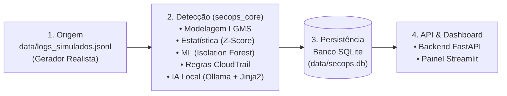

# 🛡️ SecOps Assistido por IA (Custo Zero) — Equipe Mãos na Tech

Pipeline local de **Monitoramento, Detecção Híbrida de Anomalias e Explicação via IA Local** construído para a atividade oficial **Mãos na Tech (Solução 03)**, Integrado com **Orca + Linear + GitHub via MCP & Antigravity**.

---

## 📌 1. Problema Resolvido & Arquitetura em 4 Camadas

Equipes de operações e segurança (SecOps) enfrentam fadiga de alertas em grandes volumes de logs de auditoria em nuvem (como **AWS CloudTrail**), além do alto custo de SIEMs comerciais e APIs externas de LLMs.

Este projeto resolve o problema **100% localmente e a custo zero**:
1. **Origem (`data/logs_simulados.jsonl`):** Gera telemetria sintética realista estilo AWS CloudTrail com média ($\mu$) e desvio padrão ($\sigma$) calibrados tanto para o tráfego comercial legítimo quanto para 6 cenários reais de ataque (volumétricos e furtivos).
2. **Detecção Híbrida (`secops_core`):**
   - **LGMS (`secops_core/lgms.py`):** Valida, normaliza e extrai matriz de 16 features numéricas, cíclicas e comportamentais.
   - **Estatística (`Z-Score`):** Identifica picos volumétricos e anomalias de transferência/latência ($|Z| > 3.0$).
   - **Machine Learning (`Isolation Forest`):** Detecta anomalias multivariadas furtivas (combinação de horário atípico, IP externo, ausência de MFA e raridade da operação).
   - **Regras Determinísticas (`CloudTrail Rules`):** Avalia 6 regras críticas (`RULE_IAM_PRIVILEGE_ESCALATION`, `RULE_TRAIL_TAMPERING`, `RULE_ROOT_ACTIVITY`, `RULE_BRUTE_FORCE_CONSOLE`, `RULE_UNAUTHORIZED_API_BURST`, `RULE_SENSITIVE_S3_PUBLIC_ACCESS`).
   - **Explicação em Linguagem Simples (`Ollama + Jinja2`):** Traduz alertas técnicos em 4 seções claras em português (*O que aconteceu*, *Por que foi considerado anômalo*, *Risco Potencial* e *Ação Recomendada*), com **Fallback Inteligente Jinja2** caso o Ollama local esteja desligado.
3. **Persistência (`SQLite` — `data/secops.db`):** Armazenamento transacional idempotente (`UPSERT`) com índices de alta performance (`< 100ms`).
4. **API & Dashboard (`FastAPI` + `Streamlit`):** Exposição REST documentada via OpenAPI/Swagger e painel interativo com KPIs executivos, séries temporais e investigação de alertas.



---

## 🚀 2. Guia Rápido de Execução Local em Menos de 5 Minutos (Custo Zero)

### Passo 1: Instalar dependências
```powershell
python -m pip install -r requirements.txt
```

### Passo 2: Gerar os logs sintéticos e rodar o pipeline híbrido (com explicações IA)
```powershell
python -m secops_core.generator --count 1500 --anomaly-rate 0.06 --seed 42
python -m secops_core.pipeline --explain
```

### Passo 3: Subir a API REST FastAPI (Opcional — o Streamlit também possui modo de serviço local integrado)
```powershell
python -m uvicorn api.main:app --host 0.0.0.0 --port 8000 --reload
```
* Documentação interativa Swagger UI: `http://localhost:8000/docs`

### Passo 4: Abrir o Painel Interativo Streamlit
```powershell
python -m streamlit run dashboard/app.py
```

### Passo 5: Executar a Suíte de Testes Automatizados (`pytest`)
```powershell
python -m pytest -v
```

---

## 👥 3. Contribuição por Papel na Equipe (Mãos na Tech)

| Papel | Entregas Técnicas Construídas no Repositório |
| :--- | :--- |
| **Arquiteto de Solução / Tech Lead** | Arquitetura modular `secops_core`, modelo canônico LGMS ([`secops_core/lgms.py`](secops_core/lgms.py)), modelagem SQLite ([`secops_core/db.py`](secops_core/db.py)) e orquestração em [`secops_core/pipeline.py`](secops_core/pipeline.py). |
| **Cloud Practitioner / SecOps Analyst** | Calibração de cenários de ataque realistas em [`secops_core/generator.py`](secops_core/generator.py) e motor de 6 regras determinísticas AWS CloudTrail em [`secops_core/detectors/cloudtrail_rules.py`](secops_core/detectors/cloudtrail_rules.py). |
| **Cientista de Dados** | Engenharia de 16 features temporais/comportamentais, detector estatístico [`secops_core/detectors/zscore_detector.py`](secops_core/detectors/zscore_detector.py) e detector não supervisionado [`secops_core/detectors/isolation_forest.py`](secops_core/detectors/isolation_forest.py). |
| **Backend Developer** | Integração com IA local e Fallback Jinja2 ([`secops_core/explainer/ollama_client.py`](secops_core/explainer/ollama_client.py)) e API REST completa em [`api/main.py`](api/main.py) / [`api/schemas.py`](api/schemas.py). |
| **Infraestrutura / Frontend Developer** | Dashboard executivo e investigativo em [`dashboard/app.py`](dashboard/app.py), configuração de ambiente ([`.env.example`](.env.example), [`pyproject.toml`](pyproject.toml)) e testes automatizados em [`tests/`](tests/). |

---

## ✅ 4. Checklist Oficial MãosNaTech (Antes de Publicar a Solução)

- [x] **1. O problema que a solução resolve está claro e documentado?** Sim — detecção híbrida e explicação acessível de anomalias de segurança em logs de infraestrutura sem custos de nuvem ou de APIs pagas.
- [x] **2. As permissões seguem o princípio do menor privilégio?** Sim — execução 100% local restrita ao diretório do projeto, banco SQLite local sem exposição externa e regras que auditam violações de privilégio (`RULE_IAM_PRIVILEGE_ESCALATION`, `RULE_ROOT_ACTIVITY`).
- [x] **3. O custo estimado é zero (Free Tier / Local)?** Sim — R$ 0,00 / US$ 0,00 (Python + SQLite + Scikit-Learn + Ollama/Jinja2 + FastAPI + Streamlit locais).
- [x] **4. A contribuição de cada papel da equipe está registrada?** Sim — documentada na Seção 3 deste README e no backlog detalhado em [`PLANEJAMENTO_SCRUM_MAOS_NA_TECH.md`](PLANEJAMENTO_SCRUM_MAOS_NA_TECH.md).
- [x] **5. Qualquer pessoa consegue reproduzir o projeto seguindo o README?** Sim — guia passo a passo validado em menos de 5 minutos com testes automatizados (`python -m pytest -v`).

---

## 📂 Materiais Adicionais do Repositório
* 📋 **[PLANEJAMENTO_SCRUM_MAOS_NA_TECH.md](PLANEJAMENTO_SCRUM_MAOS_NA_TECH.md)**: Planejamento Scrum de 4 semanas, cerimônias e especificação completa das 16 tasks (`SEC-01` a `SEC-16`).
* 📕 **[Tutorial_Orca_Linear_MCP.pdf](Tutorial_Orca_Linear_MCP.pdf)** & **[TUTORIAL_ORCA_LINEAR_MCP.md](TUTORIAL_ORCA_LINEAR_MCP.md)**: Manual técnico de orquestração Orca + Linear + GitHub via MCP.
* 🌐 **[index.html](index.html)**: Página interativa da documentação.
